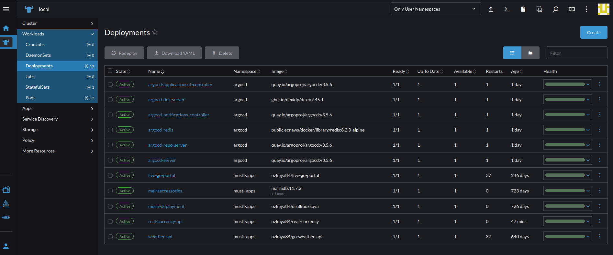
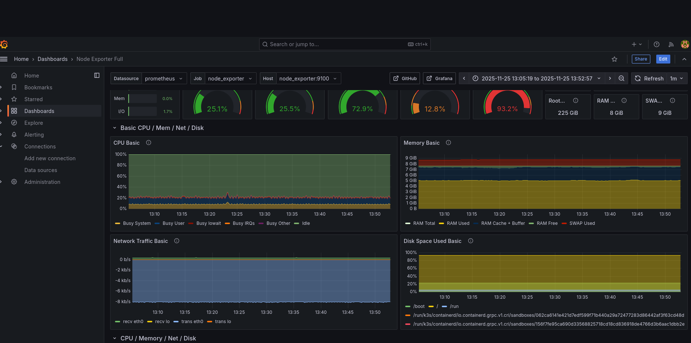
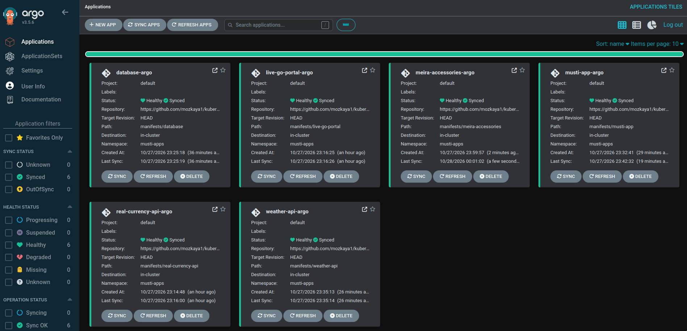
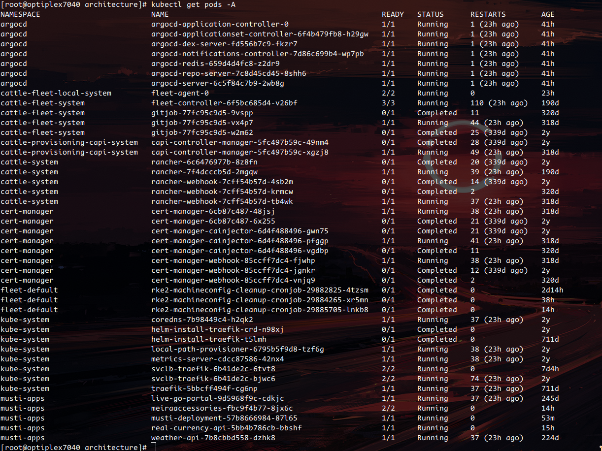
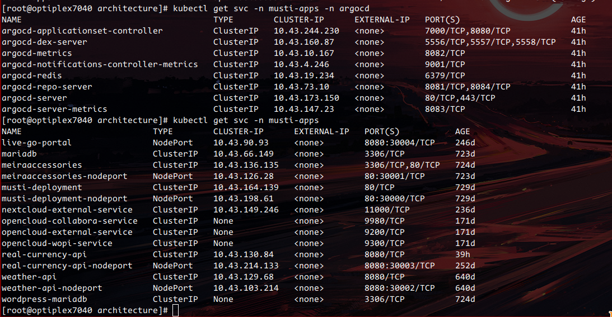

# 🚀 Production-Ready Kubernetes & GitOps Infrastructure Setup


This repository demonstrates an enterprise-grade, production-ready microservices architecture orchestrated on **Kubernetes (Rancher/K3s)**, provisioned via **Terraform (IaC)**, and continuously deployed using **ArgoCD (GitOps)**.

---

## 🏗️ Architecture & DevOps Workflow

```text
[ Git Repository ] 
       │ (Push/PR)
       ▼
[ ArgoCD (GitOps) ] ──(Sync)──► [ Kubernetes Cluster (Rancher / K3s) ]
                                      │
        ┌─────────────────────────────┼─────────────────────────────┐
        ▼                             ▼                             ▼
[ Traefik Ingress ]          [ Go Microservices ]          [ Databases ]
  ├── Live Portal              ├── Weather API               ├── MariaDB
  ├── Meira Accessories        ├── Currency API              └── PostgreSQL
  └── Musti App                └── Real-time WebSocket
```

---

## 📦 Deployed Microservices & Workloads

1. **Live Go Portal**
   - **Type:** Real-time dashboard frontend with WebSocket communication streaming live data.
2. **Weather API**
   - **Type:** Go REST API providing real-time weather data and health checks.
3. **Real Currency API**
   - **Type:** Multi-asset currency JSON data provider built in Go.
4. **Meira Accessories**
   - **Type:** E-commerce web application integrated with a dedicated **MariaDB** database layer.
5. **Musti App**
   - **Type:** Web application accessible internally via ClusterIP and externally via NodePort/Ingress.
6. **Observability Stack**
   - **Prometheus:** Metrics collection and resource monitoring.
   - **Grafana:** Visual dashboards for cluster performance and health tracking.

---

## 🛠️ Technical Stack

- **Orchestration & Management:** Kubernetes v1.28+, Rancher 2.9.3, K3s
- **Infrastructure as Code (IaC):** Terraform
- **Continuous Delivery & GitOps:** ArgoCD
- **Networking & Ingress:** Traefik Ingress Controller
- **Backend Services:** Golang (REST APIs, WebSockets), Python, Bash
- **Databases:** MariaDB, PostgreSQL
- **Monitoring:** Prometheus, Grafana

---

## 📂 Repository Structure

```text
kubernetes-production-setup/
├── terraform/          # Infrastructure provisioning scripts & modules
├── argocd/             # GitOps application manifests and sync policies
├── manifests/          # Raw Kubernetes YAML manifests
├── helm-charts/        # Reusable Helm charts for microservices
├── documentation/      # Architecture blueprints and runbooks
└── scripts/            # Deployment, automation, and maintenance scripts
```

---

## 🚀 Quick Start & Deployment

### 1. Provision Infrastructure (Terraform)
```bash
cd terraform/
terraform init
terraform apply
```

### 2. GitOps Continuous Deployment (ArgoCD)
```bash
# Apply ArgoCD application definitions to manage cluster state
kubectl apply -f argocd/
```

### 3. Manual Deployment (Alternative)
```bash
# Deploy raw manifests
kubectl apply -f manifests/

# Or deploy via Helm charts
helm install meira-accessory ./helm-charts/web-app
helm install weather-api ./helm-charts/go-api-app
```

---

## 📊 Visual Dashboards

### Rancher Cluster Management


### Grafana Observability


### ArgoCD Continuous Deployment


### Kubernetes PODS 


### Kubernetes Service 


